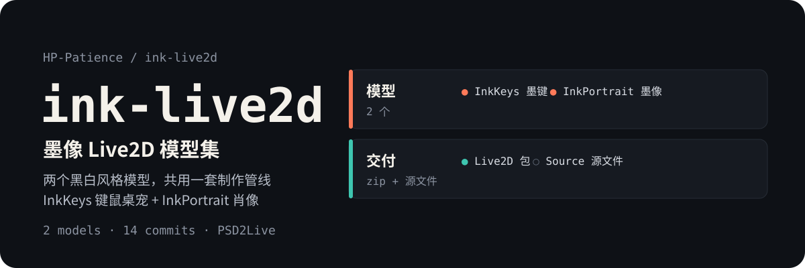

<p align="center">
  
</p>

<p align="center">
  <strong>两个黑白风格 Live2D 模型：适配 BongoCat 的键鼠桌宠 InkKeys，以及肖像模型 InkPortrait。</strong><br>
  同一套 PSD2Live 制作管线产出，交付包与源文件都在仓内，可直接导入使用。
</p>

<p align="center">
  <a href="https://github.com/HP-Patience/ink-live2d"></a>
  <a href="https://github.com/HP-Patience/ink-live2d"></a>
  <a href="#模型"></a>
  <a href="https://github.com/HP-Patience/ink-live2d"></a>
</p>

## 这是什么

「墨像」系列 Live2D 模型集。两个模型都是黑白高对比风格，共用一套从 PSD 到 Live2D 的制作管线，所以放在一个仓里而不是拆成两个。

## 目录

| 目录 | 模型 | 用途 |
|---|---|---|
| `InkKeys/` | InkKeys（墨键） | 黑白 Q 版键鼠桌宠，黑发、方框眼镜、黑高领，手在键鼠上；按键联动蓝色高亮，适配 BongoCat 1.11+ |
| `InkPortrait/` | InkPortrait（墨像） | 黑白肖像模型，用于直播与视频 |

每个目录下 `delivery/` 是可直接导入的成品，`source/` 是 PSD 与分层源文件，`tools/` 是打包与校验脚本。

## 怎么用

**BongoCat：**

```text
BongoCat → 模型列表 → 导入 → 选择 InkKeys-Live2D.zip
```

或把 `delivery/InkKeys` 整个文件夹复制到 BongoCat 的用户模型目录，重新扫描。

## 说明

模型制作与按键高亮相关的提交历史完整保留在这里；早期在 `ink-bongocat-live2d` 仓里开发，资产已整体迁入本仓。
