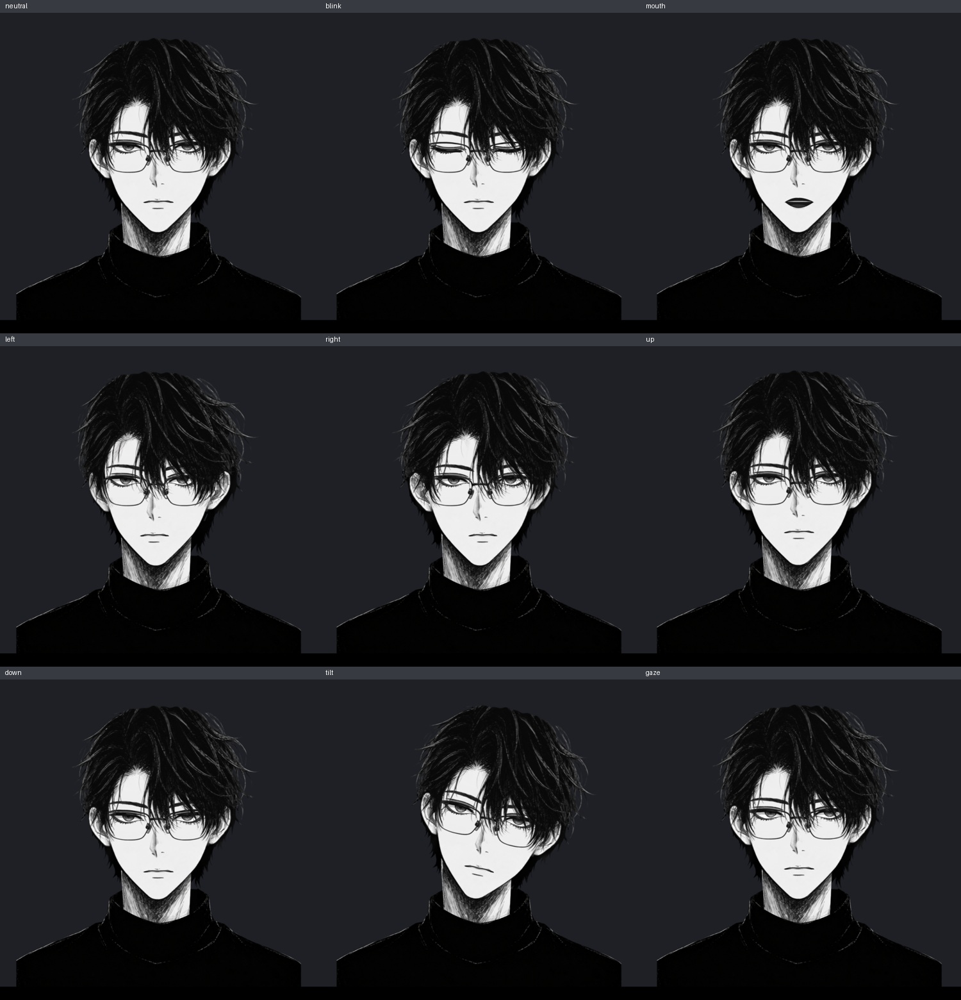
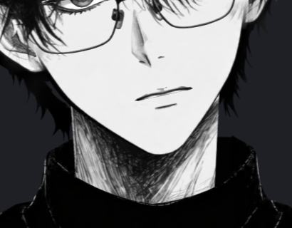
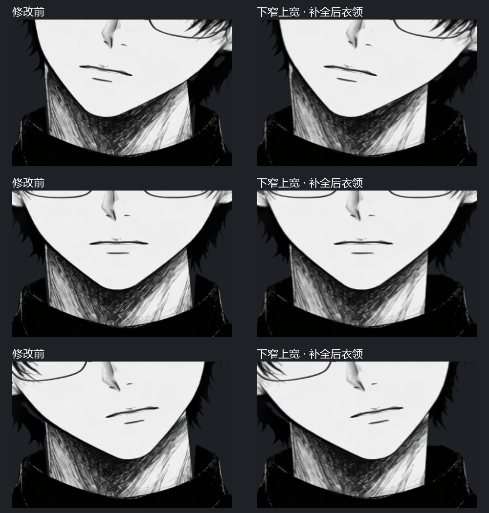

# Ink Portrait Live2D

**让一幅黑白肖像，从静止到有呼吸。**

A monochrome portrait brought to life — model, editable sources, tools, and a documented workflow.

[下载 v6](https://github.com/HP-Patience/ink-portrait-live2d/releases/tag/v6.0.0) · [使用说明](docs/USAGE.md) · [制作流程](docs/WORKFLOW.md) · [验证记录](docs/VALIDATION.md)

*录自 v6 的 Cubism Web 运行画面，不是静态图片摆动特效。*

## 这是什么

把一张正面黑白人物插画制作成可运行的 Live2D 模型，保留从自动分层、图层修复到绑定导出的过程。最终版为 **v6**：修正下睫毛跟随、耳朵重影与头顶轮廓，脖颈采用**上宽下窄的直线边缘**，并补全独立的后衣领。

这是一份针对本张肖像的模型与复现记录，**不是上传任意图片就能自动得到商业精绑模型的通用工具**。自动分层之后仍需轮廓修复、遮挡补全和运行时检查。

| 最终交付 | 规格 |
|---|---|
| 运行模型 | MOC3、model3.json、物理、动作、参数说明、完整贴图 |
| 可编辑源文件 | PSD + CMO3 + 20 张最终部件 PNG |
| 源画布 | 1280 × 1440 |
| 运行网格 | 23 个 Drawable / 4,585 个顶点 |
| 参数与贴图 | 18 个参数 / 1 张 4096 × 4096 纹理 |
| 已验证运行环境 | Cubism SDK for Web 5-r.5 / WebGL2 |

## 效果展示

脖颈与后衣领修复细节

[MP4 预览](docs/images/InkPortrait-v6-preview.mp4) · [完整正面截图](docs/images/InkPortrait-v6-neutral.png) · [历次修正](docs/CHANGELOG.md)

## 直接使用模型

1. 在 [Releases](https://github.com/HP-Patience/ink-portrait-live2d/releases/tag/v6.0.0) 下载 `InkPortrait-Live2D-v6.zip`。
2. 将解压后的整个 `models/InkPortrait` 文件夹放入 VTube Studio 的模型目录，保留所有相对路径。
3. 加载模型并配置跟踪输入。建议歪头输出范围先设为 **−12°～12°**。

需要完整制作资料时，下载同一 Release 的 **InkPortrait-Production-v6.zip**：包含本仓库文件及两个固定版本工具的实际源码，无需再取子模块。最终模型包仅供直接导入；历史包仅作对照。

也可以直接使用 [最终模型目录](models/InkPortrait)。网页预览的歪头限幅仅属于播放器逻辑，不会自动成为 VTube Studio 的参数限制。**未进行 VTube Studio 摄像头实测**；详见 [使用说明](docs/USAGE.md)。

## 仓库内容

- [models/InkPortrait](models/InkPortrait)：最终 v6 运行模型。
- [source](source)：原画、最终 PSD / CMO3、最终 PNG，以及原始自动分层 PSD、深度与元数据。
- [tools](tools)、[vendor](vendor)、[patches](patches)：制作脚本、固定提交的工具源码子模块、推理补丁。
- [preview/overrides](preview/overrides)：官方 SDK 示例的本项目修改文件。
- [tests](tests)、[validation](validation)：回归检查、导出日志、推理统计与资产 SHA-256。
- [docs](docs)：制作流程、最终展示和历史对比；[licenses](licenses)：第三方许可。

## 从保存的分层结果复现

不需要 GPU，也不需要重新下载神经网络权重。使用 **Python 3.12、Java 21、Git**：

~~~bash
git clone --recurse-submodules https://github.com/HP-Patience/ink-portrait-live2d.git
cd ink-portrait-live2d
python -m venv .venv
# Windows PowerShell: .venv\Scripts\Activate.ps1
# macOS / Linux: source .venv/bin/activate
python -m pip install -r requirements.txt
python tools/setup_tools.py
python tools/rebuild.py
python tools/verify_delivery.py
~~~

产物输出到被忽略的 `workspace/`，不会覆盖最终交付。重建脚本逐像素核对 20 张最终图层；模型导出以结构/运行检查为准，不承诺二进制逐字节相同。

**网页预览、回归检查和可选 GPU 重新分层：**[工具安装与命令](docs/TOOLS.md)。GitHub 自动生成的源码 ZIP 不包含子模块内容；请递归克隆，或运行 `git submodule update --init --recursive`。

## 制作路线

原始肖像 → See-through NF4 自动分层 → 肖像专用轮廓与遮挡修复 → PSD2Live 网格 / 参数 / 物理 / 导出 → Cubism Web 实际运行验证。

- [完整制作流程](docs/WORKFLOW.md)：修图、下睫毛绑定、头顶和后衣领处理。
- [版本演进](docs/CHANGELOG.md)：保留 v1–v6 的过程，历史效果不冒充最终效果。
- [验证与已知限制](docs/VALIDATION.md)：自动检查覆盖范围与尚未实测项目。

## 来源与权利

使用 [PSD2Live](https://github.com/tsunehimatoi/psd2live) 和 [See-through](https://github.com/shitagaki-lab/see-through)；[AstraLayering](https://github.com/wu-tian807/AstraLayering) 仅作调研，未使用其推理结果。

**不重新分发专有 Cubism Core、完整官方 SDK、神经网络权重或本地运行环境。** 下载入口、源码固定版本及本项目修改均已保留。原画、衍生模型和第三方代码的权利分别处理，**没有将整仓库声明为 MIT**。详见 [权利与第三方许可](docs/RIGHTS.md)。
